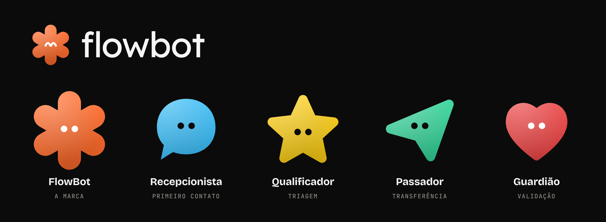

# Identidade visual do FlowBot

Tudo o que é preciso para aplicar a identidade em qualquer tela do FlowBot: landing, editor, simulação e materiais.



## O que tem aqui

| Arquivo | Para que serve |
| --- | --- |
| [`manual-da-marca.md`](manual-da-marca.md) | Logo, cor de marca, tipografia, voz, movimento e o que não fazer. |
| [`tokens-de-cor.md`](tokens-de-cor.md) | Todas as cores do sistema: primitivos, papéis (texto, fundo, estados), agentes e patentes, com contraste conferido. |
| [`agentes.md`](agentes.md) | Os cinco personagens, como desenhar cada um no código, olhos, boinas de patente e animações. |
| [`analise-flow.md`](analise-flow.md) | O que aproveitar de UX/UI do Flow (cortai-app) e o que deixar de fora. |
| `tokens/tokens.css` | Variáveis CSS prontas, tema escuro como padrão e `[data-theme="light"]` para o claro. |
| `tokens/tokens.json` | Os mesmos tokens em JSON, fonte única de onde o CSS foi gerado. |
| `tokens/contraste.json` | Os 90 pares de texto e fundo conferidos, com a razão de contraste de cada um. |
| `assets/logo/` | Símbolo (normal, plano, uma cor clara e escura), assinaturas em PNG 2x e `favicon.svg`. |
| `assets/agentes/` | Os cinco agentes em SVG. |
| `assets/boinas/` | As seis boinas de patente em SVG. |
| `assets/previas/` | Imagens de referência do logo, do time e das patentes. |

O design system navegável, com prévias dos componentes, fica no Claude: https://claude.ai/artifact/SFmg1JwdzRYSRjc2W9bPV7

## Como aplicar numa tela nova

1. **Fontes.** No `<head>`:
   ```html
   <link rel="preconnect" href="https://fonts.googleapis.com">
   <link rel="preconnect" href="https://fonts.gstatic.com" crossorigin>
   <link href="https://fonts.googleapis.com/css2?family=Lexend:wght@400&family=Bricolage+Grotesque:opsz,wght@12..96,600;12..96,700&family=Inter:wght@400;500;550;600&family=JetBrains+Mono:wght@500;600&display=swap" rel="stylesheet">
   ```
2. **Cores.** Copie `tokens/tokens.css` e use só as variáveis de papel (`var(--text)`, `var(--surface)`, `var(--accent)`). Os primitivos (`--laranja-500`, `--neutro-900`) existem para criar papéis novos, não para usar direto na tela.
3. **Tema.** O escuro é o padrão. Para o claro, ponha `data-theme="light"` no `<html>` ou num contêiner.
4. **Favicon.** `<link rel="icon" href="assets/logo/favicon.svg" type="image/svg+xml">`.
5. **Logo na navegação.** Símbolo de 28px e `flowbot` em Lexend 400, 21px, espaçamento −0,02em, cor `var(--text)`.
6. **Agentes.** Use os SVG de `assets/agentes/` como imagem, ou desenhe no código seguindo `agentes.md` quando precisar animar.

## Regras de implementação

Inspiradas no contrato de design do Flow (veja `analise-flow.md`):

- **Só tokens.** Nenhuma cor em hexadecimal solta no código de tela. Se faltar um papel, crie o token primeiro.
- **Um botão principal por tela.** O resto é secundário (contorno) ou texto.
- **Toque mínimo de 48px** e texto mínimo de 12px.
- **Foco sempre visível:** `outline: 2px solid var(--focus-ring); outline-offset: 3px`.
- **Movimento:** 120 / 200 / 280 ms em interface; quique só nos agentes e no título da landing. Com `prefers-reduced-motion`, só esmaecer.
- **Ações sensíveis** (publicar fluxo, apagar bloco) pedem confirmação. Apagar sem confirmação só com "Desfazer" por 5 s.
- **Carregamento:** esqueleto no formato do conteúdo em `--surface-sunken`; nada de rodinha no meio da tela.
- **Validar sempre em 390px e 1280px**, nos dois temas.
- **Conteúdo fictício** em demonstrações precisa dizer que é fictício.
