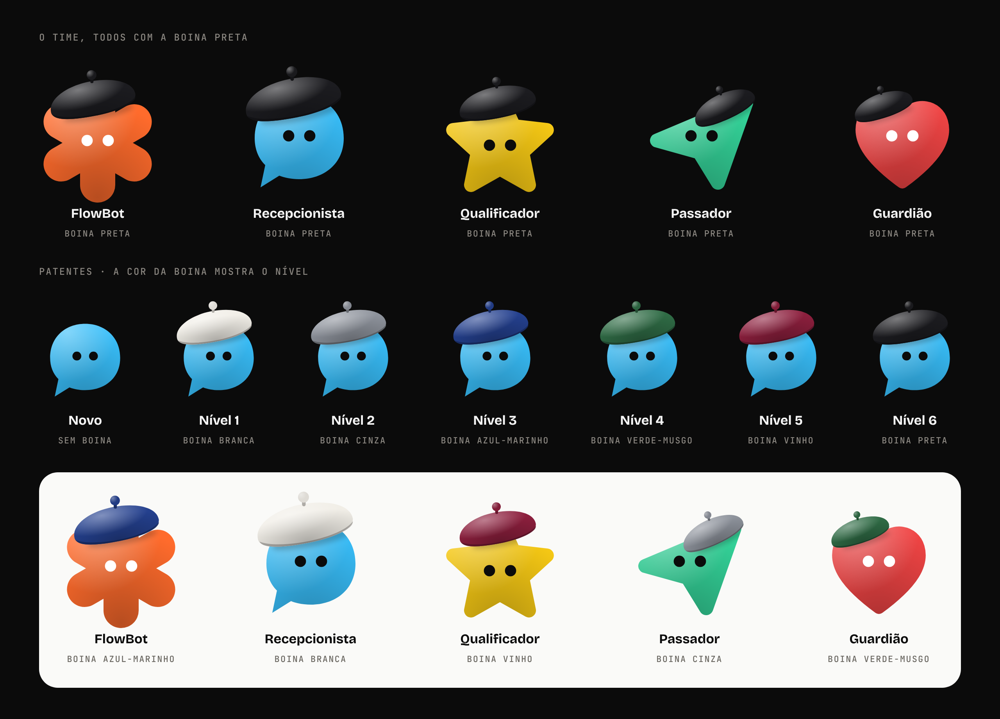

# Agentes



| Personagem | Forma | Cor | Trabalho | Movimento próprio |
| --- | --- | --- | --- | --- |
| FlowBot | asterisco de 6 pontas | `--agent-flowbot` #FF6B2C | a marca | gira devagar |
| Recepcionista | balão de chat | `--agent-recepcionista` #38BDF8 | abre a conversa | flutua |
| Qualificador | estrela | `--agent-qualificador` #FACC15 | pergunta e ramifica | balança |
| Passador | avião de papel | `--agent-passador` #34D399 | passa para a equipe | flutua |
| Guardião | coração | `--agent-guardiao` #EF4444 | segura o erro | fica firme |
| Agente novo | raio | `--agent-novo` #A78BFA (ou outra escolhida) | o que o usuário criar | flutua |

Em espera para o futuro: selo com visto, cadeado, sino e cone.

## Como desenhar no código

Todo agente usa uma caixa `viewBox="0 0 100 100"`. A forma vira uma **máscara** e por cima vão três camadas: a cor, uma sombra embaixo e um brilho no alto à esquerda. Os olhos ficam fora da máscara.

```js
const arms=(n,L)=>{let d='';for(let i=0;i<n;i++){const a=-Math.PI/2+i*2*Math.PI/n;d+=`M50,52 L${50+L*Math.cos(a)},${52+L*Math.sin(a)} `}return d};
const starD=(()=>{let q='';for(let i=0;i<10;i++){const a=-Math.PI/2+i*Math.PI/5,r=i%2?20:42;q+=(i?'L':'M')+(50+r*Math.cos(a))+','+(54+r*Math.sin(a))}return q+'Z'})();
// f: a forma (%c = cor da máscara) · ey: altura dos olhos · cap: onde a boina assenta [x, y, giro, escala]
const AGENTES={
  flowbot:      {f:`<path d="${arms(6,36)}" fill="none" stroke="%c" stroke-width="30" stroke-linecap="round"/><circle cx="50" cy="52" r="28" fill="%c"/>`, ey:50, cap:[46,17,-11,.8]},
  recepcionista:{f:`<path d="M12,48C12,25 29,11 50,11C71,11 88,25 88,48C88,70 71,83 50,83C44,83 38,82 33,80L17,90L21,71C15,65 12,57 12,48Z" fill="%c"/>`, ey:46, cap:[45,17,-11,.9]},
  qualificador: {f:`<path d="${starD}" fill="%c" stroke="%c" stroke-width="12" stroke-linejoin="round"/>`, ey:54, cap:[48,20,-11,.72]},
  passador:     {f:`<path d="M12,50 L88,18 L64,86 L48,60 Z" fill="%c" stroke="%c" stroke-width="12" stroke-linejoin="round"/>`, ey:46, cap:[70,23,-24,.6]},
  guardiao:     {f:`<path d="M50,86 C20,64 12,48 16,34 C20,20 38,16 50,30 C62,16 80,20 84,34 C88,48 80,64 50,86 Z" fill="%c" stroke="%c" stroke-width="10" stroke-linejoin="round"/>`, ey:46, cap:[34,22,-18,.56]},
  novo:         {f:`<path d="M58,10 L22,58 L46,58 L40,92 L78,42 L54,42 Z" fill="%c" stroke="%c" stroke-width="10" stroke-linejoin="round"/>`, ey:48, cap:[56,19,-14,.62]},
};
```

```html
<svg viewBox="0 0 100 100">
  <defs>
    <mask id="m"><!-- AGENTES.x.f com %c = #fff --></mask>
    <radialGradient id="sombra" cx=".5" cy=".95" r=".75"><stop offset="0" stop-opacity=".28"/><stop offset="1" stop-opacity="0"/></radialGradient>
    <radialGradient id="brilho" cx=".32" cy=".22" r=".5"><stop offset="0" stop-color="#fff" stop-opacity=".38"/><stop offset="1" stop-color="#fff" stop-opacity="0"/></radialGradient>
  </defs>
  <g mask="url(#m)">
    <rect x="-4" y="-4" width="108" height="108" fill="var(--agent-recepcionista)"/>
    <rect x="-4" y="-4" width="108" height="108" fill="url(#sombra)"/>
    <rect x="-4" y="-4" width="108" height="108" fill="url(#brilho)"/>
  </g>
  <!-- olhos: deslocar em y por (ey - 48) -->
  <circle cx="41" cy="46" r="4.8" fill="#0B0B0B"/><circle cx="59" cy="46" r="4.8" fill="#0B0B0B"/>
</svg>
```

A implementação completa, com animação, está em `landing/index.html` (procure por `SHAPES` e `class Stage`).

## Olhos

| Estado | Desenho | Quando |
| --- | --- | --- |
| Atento (padrão) | dois pontos, raio 4,8, em x 41 e 59 | sempre |
| Contente | dois arcos (`M35,53 q6,-14 12,0`) | depois de concluir, no logo |
| Arregalado | dois pontos de raio 6,4 | caindo, surpreso |
| Reto | dois traços | apagado (cena da dor) |

Cor dos olhos: **preta** (#0B0B0B) quando o corpo é claro (luminância acima de 0,42: Recepcionista, Qualificador, Passador); **branca** nos outros (FlowBot, Guardião, agente novo violeta). Piscam a cada 4,6 s, cada um com atraso diferente, e seguem o cursor até 5px.

## Patentes

A boina mostra o nível do agente. O desenho é sempre o mesmo; só muda a cor.

| Nível | Boina | Token | Arquivo |
| --- | --- | --- | --- |
| Novo | sem boina | — | — |
| 1 | branca | `--patente-1` | `boina-1-branca.svg` |
| 2 | cinza | `--patente-2` | `boina-2-cinza.svg` |
| 3 | azul-marinho | `--patente-3` | `boina-3-azul-marinho.svg` |
| 4 | verde-musgo | `--patente-4` | `boina-4-verde-musgo.svg` |
| 5 | vinho | `--patente-5` | `boina-5-vinho.svg` |
| 6 | preta (o topo) | `--patente-6` | `boina-6-preta.svg` |

**Como a boina é feita:** almofada larga (92 de largura por 37 de altura em escala 1), faixa mais escura na base (a cor escurecida 28%), bolinha no topo com um pino curto, mesmo brilho e sombra dos agentes. Ela fica inclinada para a esquerda e projeta uma sombra leve na cabeça, dentro da máscara do agente.

**Encaixe por agente** (`cap` na tabela acima: posição, giro e escala):
- FlowBot e Recepcionista: em cima, tamanho cheio.
- Qualificador: cobre a ponta de cima da estrela.
- Passador: menor, acompanhando a ponta de cima do avião.
- Guardião: só no lado esquerdo do coração, para ele continuar parecendo um coração.

**Ao subir de nível:** a boina cai de cima girando (620 ms, mola), o agente amassa ao receber, os olhos viram arco e sai um anel na cor da boina. No nível 6, também confete.

## Animações

| Nome | Como | Duração |
| --- | --- | --- |
| Pulo | amassa (1,13 × 0,85), sobe esticando (0,93 × 1,09), amassa e volta | 440 ms |
| Amasso | 1,2 × 0,78 e volta | 300 ms |
| Queda | cai girando até o cartão com quique em 4 tempos | 820–980 ms |
| Fala | balão branco sobe com mola e some depois de 2 s | 380 ms |
| Comemoração | anel que cresce e some + 26 a 46 confetes | 800 ms |
