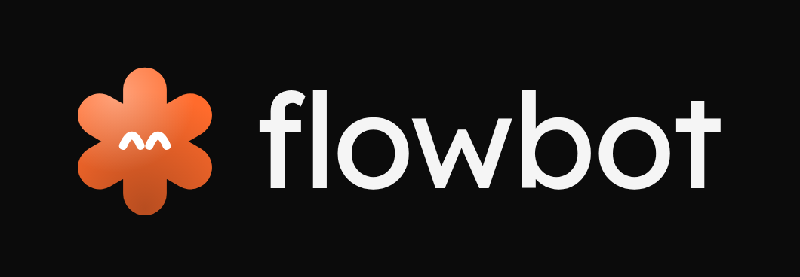

# Manual da marca FlowBot

**Teste a conversa antes do cliente.**

FlowBot é o módulo do Nexus para montar e simular fluxos de atendimento. A marca passa uma ideia: nada chega ao cliente sem ter sido testado antes. Fundo escuro e calmo; na frente, personagens simples que qualquer pessoa reconhece.

## Princípios

1. **Escuro primeiro.** O tema escuro é a marca. O claro serve para documentos e telas de trabalho longas.
2. **Formas que todo mundo reconhece.** Cada agente é um objeto do dia a dia. Bate o olho e sabe o que é.
3. **Um acento só.** O laranja é do FlowBot: símbolo, ação principal de marca, foco, cursor e comemoração.
4. **Movimento com mola, não com pressa.** Personagens quicam; a interface desliza.
5. **Mostrar, não prometer.** Tudo é simulação que a pessoa pode tocar. Nada de número inventado apresentado como real.

## Logo

- **Símbolo:** asterisco de 6 pontas laranja (`--agent-flowbot`, #FF6B2C), gordinho, com olhos em arco brancos.
- **Nome:** `flowbot`, sempre em minúsculas, em **Lexend 400**, espaçamento −0,02em.
- **Assinatura:** símbolo à esquerda, nome à direita; a distância entre eles é 1/5 da altura do símbolo.

| Arquivo | Quando usar |
| --- | --- |
| `flowbot-simbolo.svg` | Padrão, com volume. Avatar, ícone de app, materiais. |
| `flowbot-simbolo-plano.svg` / `favicon.svg` | Sem sombreado, abaixo de 24px e em impressão. |
| `flowbot-simbolo-mono-claro.svg` | Uma cor, #F5F5F5, sobre fundo escuro ou foto escura. |
| `flowbot-simbolo-mono-escuro.svg` | Uma cor, #0B0B0B, sobre fundo claro. |
| `flowbot-assinatura-escuro.png` / `-claro.png` | Assinatura completa em PNG 2x. |

**Respiro:** metade da largura do símbolo em volta de tudo. **Tamanho mínimo:** símbolo de 16px; assinatura de 96px de largura.

**Não faça:** girar, trocar a cor do símbolo, colocar contorno, sombra ou textura, esticar, escrever `FlowBot` com maiúsculas no logo, aplicar sobre foto sem a versão de uma cor. Em texto corrido, o nome é escrito **FlowBot**.

## Cor de marca

| Papel | Escuro | Claro |
| --- | --- | --- |
| Fundo | #0B0B0B | #FAFAF8 |
| Texto | #F5F5F5 | #0B0B0B |
| Acento (laranja) | #FF6B2C | #C2410C |

O sistema completo de cores, com estados, bordas e contraste, está em [`tokens-de-cor.md`](tokens-de-cor.md).

## Tipografia

| Uso | Fonte | Peso | Detalhes |
| --- | --- | --- | --- |
| Nome no logo | Lexend | 400 | Minúsculas, −0,02em. Só no logo. |
| Títulos | Bricolage Grotesque | 700 (600 em títulos pequenos) | Entrelinha 0,98, espaçamento −0,045em. |
| Texto | Inter | 400 · 500 · 550 · 600 | 16px base, entrelinha 1,55. |
| Rótulos, horários, números | JetBrains Mono | 500 | Rótulos em maiúsculas, espaçamento 0,12em. |

| Estilo | Tamanho | Uso |
| --- | --- | --- |
| Título de abertura | clamp(46px, 8.4vw, 116px) | Uma vez por página. |
| Título de seção | clamp(38px, 6.2vw, 80px) | Abre cada seção. |
| Título de cartão | 24px | Nome de agente, título de painel. |
| Lead | clamp(16px, 1.7vw, 19px) | Subtítulo, em `--text-muted`. |
| Texto | 16px | Corrido. |
| Conversa | 14px | Bolhas da simulação. |
| Rótulo | 12px mono | Acima do título de seção, com o ponto laranja. |
| Meta | 11px mono | Horário, tipo de bloco, contador. |

## Forma e superfície

- **Cartões:** `--surface`, borda de 0,5px em `--border`, raio de 24px.
- **Botão principal:** pílula de 46px com fundo `--text` e texto `--text-inverse` (parece uma tecla). Botão de marca: fundo `--accent`, texto `--on-accent`.
- **Botão secundário:** só contorno em `--border`.
- **Fundo de cena:** manchas de luz laranja e violeta flutuando devagar, grade de pontos de 26px e granulado leve. Só na landing e em telas de apresentação.

| Raio | Valor | Uso |
| --- | --- | --- |
| sm | 9px | Chips e botões de forma. |
| md | 13px | Campos e linhas de bloco. |
| lg | 24px | Cartões. |
| celular | 44px | Moldura do celular na demo. |
| pílula | 999px | Botões e respostas rápidas. |

## Voz

- Português do Brasil, frases curtas, na segunda pessoa ("você").
- Títulos são afirmações com ponto final: *"Um agente para cada etapa."*
- Os agentes falam em primeira pessoa e com poucas palavras: *"Eu pergunto."*, *"Passei a vez."*
- O bot **nunca** fala de preço, prazo ou desconto. Isso é sempre da equipe.
- Termos do produto: fluxo, bloco, ramo, simulação, equipe assume.
- Mensagens de sistema: "Pronto." · "Não deu certo. Tenta de novo?"

## Movimento

| Nome | Valor | Uso |
| --- | --- | --- |
| rápido | 120 ms | Toque, hover, troca de cor. |
| base | 200 ms | Painéis, folhas, listas. |
| lento | 280 ms | Tela inteira. |
| ease | cubic-bezier(.32,.72,0,1) | Entrada de seção. |
| spring | cubic-bezier(.34,1.56,.64,1) | Botões, título da landing, bolhas. |
| quique | 4 tempos, 0,8–1 s | Agente caindo num cartão. |

Com `prefers-reduced-motion: reduce`, tudo vira esmaecimento de 150 ms e os agentes param de piscar e quicar.
